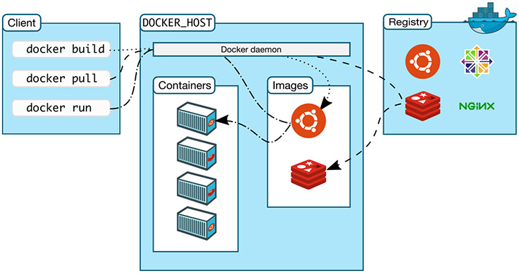

<h1>
  <span class="headline">Running Your First Docker Container</span>
  <span class="subhead">Docker Commands</span>
</h1>

**Learning objective:** By the end of this lesson, students will be able to execute essential Docker commands to create, monitor, manage, remove containers, and view container logs.

<br>



<br>
[source](https://www.loft.sh/blog/11-of-the-best-open-source-kubernetes-tools-2021-edition)

## Docker Commands

This lesson introduces key **Docker commands** that help us manage containers and images. By understanding these commands, you’ll be able to create, monitor, and clean up containers in a way that optimizes your system resources.

## 1. `docker run`

The `docker run` command does two things:

- It creates a container from a Docker image.
- It starts the container by executing its default startup command.

```bash
docker run <image-name>
```

### Example: Overriding the Default Command

You can also override the default startup command in an image.

```bash
docker run <image name> <command-to-override>
```

For example, to list files in the `busybox` image:

```bash
docker run busybox ls
```

## 2. `docker ps`

The `docker ps` command lists active containers and their statuses. It’s useful for monitoring what’s running and checking details like **container ID**, **image used**, and **uptime**.

```bash
docker ps
```

If no containers are currently running, the command will return no results. To see this in action, first try running:

```bash
docker run busybox ping google.com
```

In another terminal window, run `docker ps` to view the running container. You’ll see something like:

```plaintext
CONTAINER ID   IMAGE     COMMAND             CREATED         STATUS         PORTS     NAMES
f7eea52fa97e   busybox   "ping google.com"   7 seconds ago   Up 6 seconds             jovial_nash
```

To stop this container, press `Ctrl+C` in the terminal running the ping command.

> `jovial_nash` is just a randomly generated name to identify this container.

### Showing All Containers

To list all containers, including those that have stopped, use:

```bash
docker ps --all
```

The output will look something like this:

```text
CONTAINER ID  IMAGE        COMMAND            CREATED         STATUS                   PORTS  NAMES
2ce9bdb14238  hello-world  "/hello"           52 minutes ago  Created                         vibrant_benz
f7eea52fa97e  busybox      "ping google.com"  17 hours ago    Exited (0) 17 hours ago         jovial_nash
570646e6503c  busybox      "ls"               17 hours ago    Exited (0) 17 hours ago         intelligent_lederberg
```

## 3. `docker start`

Use `docker start` to restart a container that has been created or stopped, allowing you to reuse containers without creating new ones each time.

```bash
docker start <container-id>
```

To attach the container’s output to your terminal (useful for monitoring logs), include the `-a` flag:

```bash
docker start -a <container-id>
```

## 4. `docker stop` and `docker kill`

These commands stop a running container.

- **`docker stop`** sends a **SIGTERM** signal (short for terminate signal), giving the container a chance to finish any cleanup tasks.
- **`docker kill`** sends a **SIGKILL** signal, immediately stopping the container without cleanup time.

Use `docker stop` when you want a graceful shutdown and `docker kill` if the container is unresponsive.

### Example

Run a command to keep a container active:

```bash
docker run busybox ping google.com
```

To stop it, find the container ID with `docker ps`, then run:

```bash
docker stop <container-id>
```

## 5. `docker logs`

This command retrieves the log output of a container, whether it’s currently running or has stopped. Use the container **ID** to view logs.

```bash
docker logs <container-id>
```

This is especially helpful for troubleshooting containers that have exited unexpectedly.

> **Important Note**: You don’t need to type the entire container ID to run a command. As long as the first few characters are unique to that container, Docker can identify it. For example, if your container `ID` is `3ddc6041a39d`, you can simply use `docker stop 3dd`, and Docker will still recognize the container.

## 6. `docker pull`

The `docker pull` command downloads existing images from a Docker registry (like Docker Hub) to your local machine.

- **When to Use:**
  - When you need a pre-built image that is publicly available or that you have previously built and pushed to a registry.
  - When you want to update an existing image to the latest version.

### Example

```bash
docker pull ubuntu:latest
```

---

## 7. `docker build`

The `docker build` command creates a new Docker image from a **Dockerfile**, which contains a set of instructions on how to build that image.

- **When to Use:**
  - When you have custom application code or configurations that need to be included in a Docker image.
  - When you want to create an image that includes specific dependencies or configurations tailored to your application.

### Example

```bash
docker build -t my-custom-image:latest .
```

## 8. `docker exec`

The `docker exec` command lets you run additional commands in a running container, such as launching an interactive shell.

```bash
docker exec -it <container-id> /bin/sh
```

The `-it` flag makes the terminal interactive, so you can use shell commands like `ls` and `cd` to explore the container. Type `exit` to leave the shell.

## 9. `docker rm`

The `docker rm` command removes stopped containers, freeing up resources.

```bash
docker rm <container-id>
```

### Forcing Removal of Running Containers

To remove a running container, use the `-f` or `--force` flag:

```bash
docker rm -f <container-id>
```

## 10. `docker image ls`

Lists all images in your local Docker cache, which stores downloaded images to speed up future container creation.

```bash
docker image ls
```

## 11. `docker system prune`

This command cleans up unused resources, including stopped containers, networks, dangling images, and build cache.

**⚠ Important Note:** Do not run this command on your VM, as it will delete necessary files for upcoming lessons.

```bash
docker system prune  ***DO NOT RUN***
```

This command will generally produce a prompt like this:

```plaintext
WARNING! This will remove:

- all stopped containers
- all networks not used by at least one container
- all dangling images
- all dangling build cache

Are you sure you want to continue? [y/N]
```

Always be sure you’re okay with deleting these items before proceeding.
