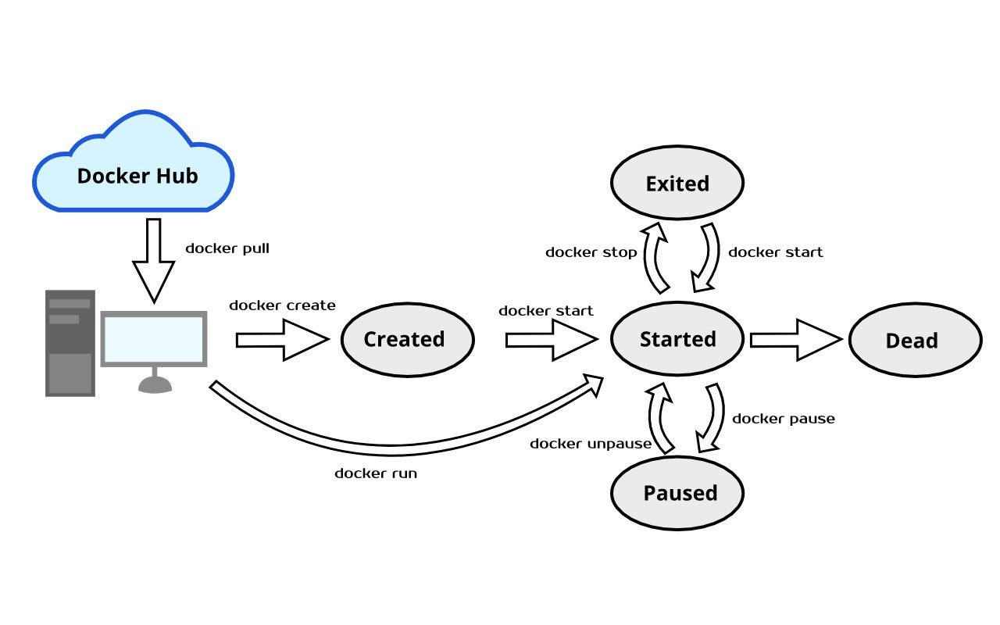

<h1>
  <span class="headline">Running Your First Docker Container</span>
  <span class="subhead">The Container Lifecycle</span>
</h1>

**Learning objective:** By the end of this lesson, students will be able to describe the basic stages of the Docker container lifecycle and demonstrate how to create, start, and stop a Docker container.

<br>



[source](https://miro.medium.com/max/2000/0*3_uIz_YMiyZxMwKn)

## Container Lifecycle

In Docker, a container goes through a lifecycle that involves creating, starting, stopping, and removing. Knowing these stages helps us better control container behavior and manage resources. In this lesson, we’ll explore the basic container lifecycle by learning how to create and start a container.

## Running Containers

When we use `docker run`, Docker is actually performing two steps:

- Create a container based on an image.
- Start the container by executing its default startup command.

This is why `docker run` is essentially `docker create` + `docker start`.

## Creating and Starting a Container

Understanding this separation allows for more granular control, such as creating multiple containers from the same image without immediately starting them.

### 1. Create a New Container

Let’s start by creating a new container without running it. Use the following command:

```bash
docker create hello-world
```

Docker will return a unique **container ID** to identify this container instance.

You should see output like this:

```text
2ce9bdb14238e8a6ba2ac68964ee8ca48e93e9cbf90d0c2c3f441d6be279e8b4
```

This is the **ID** of the container that just executed.

When a container is created the file system is prepped for use in the new container. To start the container means executing the startup command that comes with the image.

### 2. Start the Container

Now, use `docker start` to run the container with its **ID**, and use the `-a` flag to attach the output to your terminal so you can see the result:

```bash
docker start -a <your-container-id>
```

This command will produce output similar to running docker run `hello-world`, as the container is now executing its defined startup process.

### 3. Stopping a Container

To stop a running container, use the `docker stop` command. This will end the container’s process gracefully.

```bash
docker stop <your-container-id>
```

This step effectively "shuts down" the container, completing the lifecycle from creation to termination.
